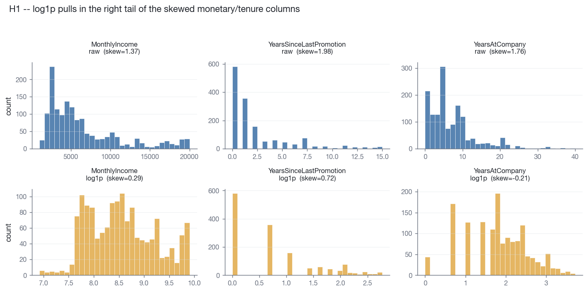
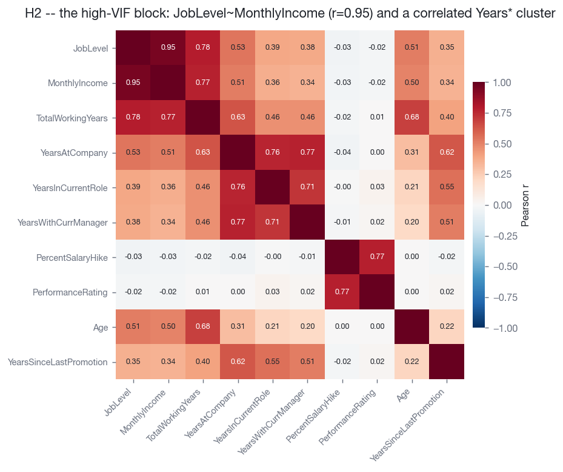
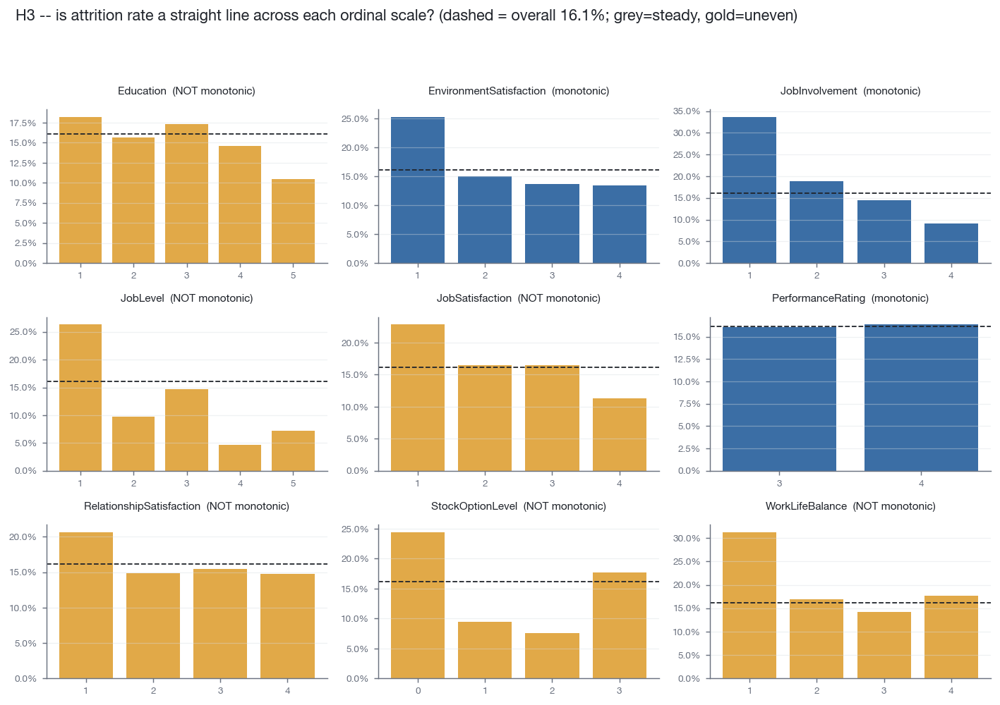
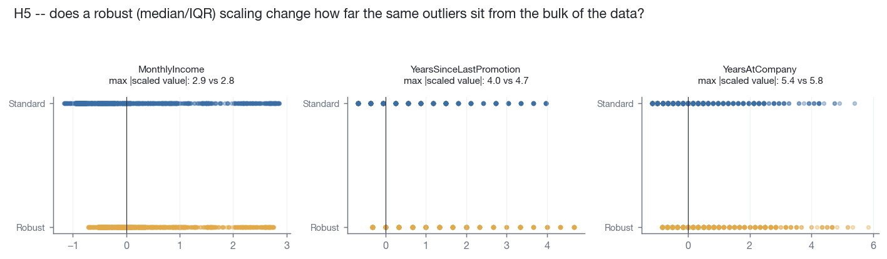
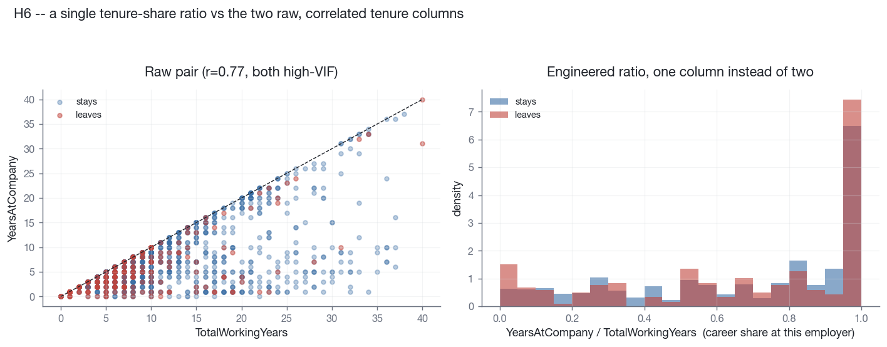

# Assignment #3 — Step 3: Hypotheses

Every hypothesis below follows the required chain **EDA finding → proposed
change → expected effect**, sourced from the EDA in
[`notebooks/00_baseline.ipynb`](../notebooks/00_baseline.ipynb) (Part 1) and
from the targeted figures generated for this step
(`src/hypotheses_figures.py` → `outputs/figures/08_*.png`–`12_*.png`).
Baseline (E0) to beat: **LR + max-out, F1 = 0.464 (95% CI 0.31–0.60)** —
see [`README.md`](../README.md).

All proposed changes are fit inside the training fold only (no leakage) and
change **one pipeline component at a time**, per the brief's E0/E1/E2/E3
protocol. None of them replace the main model — logistic regression stays
the model under test throughout, exactly as Assignment #3 requires.

---

## H1 — Log-transform the skewed monetary/tenure columns

**EDA finding.** `MonthlyIncome`, `YearsSinceLastPromotion`, and
`YearsAtCompany` are strongly right-skewed (skew 1.37, 1.98, 1.76;
7.1–7.8% of values sit beyond the 1.5×IQR fence — `eda_outliers.csv`).

A `log1p` transform pulls skew down to 0.29, 0.72, and −0.21 respectively —
close to symmetric.

**Proposed change.** Apply `log1p` to these three columns (and any other
column with |skew| > 1) inside the `ColumnTransformer`, fit on training rows
only, before standardisation.

**Expected effect.** Logistic regression is a linear-in-the-features model;
a few extreme incomes/tenures currently exert disproportionate leverage on
the fitted boundary and on `StandardScaler`'s mean/SD. Compressing the tail
should produce more stable coefficients (lower bootstrap CV, Part 2.6 of the
baseline notebook) and may modestly improve F1 and ROC-AUC by making the
decision boundary less distorted by a handful of senior, long-tenured
employees who are overwhelmingly non-leavers.

---

## H2 — Resolve the JobLevel / MonthlyIncome redundancy

**EDA finding.** `JobLevel` and `MonthlyIncome` correlate at r = 0.95 (VIF
11.2 and 10.8 — the two highest in the dataset); `TotalWorkingYears` and the
four `Years*` tenure columns form a second correlated block (r = 0.51–0.77).

**Proposed change.** Drop `JobLevel` and keep `MonthlyIncome` (income is the
finer-grained of the near-duplicate pair and is already the stronger
Cohen's-d signal per `eda_numeric_association.csv`), rather than relying on
max-out's wrapper search alone to make that call.

**Expected effect.** Removing a near-duplicate feature should shrink the
coefficient instability the bootstrap analysis already flags for this
block (Part 2.6, baseline notebook) without costing predictive signal,
since `JobLevel`'s information is ~95% contained in `MonthlyIncome`. A null
result (no F1 change) is also plausible and would itself be informative:
max-out already tends to discard the same redundant dummies it can reach,
so an explicit pre-filter may only replicate work the wrapper already does.

---

## H3 — Stop treating the ordinal survey scales as equal-interval numbers

**EDA finding.** Nine 1–4/1–5 survey scales (`Education`,
`EnvironmentSatisfaction`, `JobInvolvement`, `JobLevel`, `JobSatisfaction`,
`PerformanceRating`, `RelationshipSatisfaction`, `StockOptionLevel`,
`WorkLifeBalance`) are fed to the model as continuous numbers, which assumes
attrition rate moves in a straight line across levels.

Checking that assumption directly: **6 of 9** scales are *not* monotonic.
`Education` and `JobSatisfaction` dip and recover; `JobLevel`,
`RelationshipSatisfaction`, `StockOptionLevel`, and `WorkLifeBalance` show
level-1 (or level-0) employees as outliers rather than one end of a trend.
Only `EnvironmentSatisfaction`, `JobInvolvement`, and the near-binary
`PerformanceRating` are genuinely monotonic.

**Proposed change.** One-hot encode the six non-monotonic scales instead of
passing them through as numeric; leave `EnvironmentSatisfaction`,
`JobInvolvement`, and `PerformanceRating` numeric, since a straight line is
already a reasonable fit for those three.

**Expected effect.** For the six non-monotonic scales, one-hot encoding lets
logistic regression fit a separate coefficient per level instead of forcing
a single slope through a non-linear relationship, which should improve fit
on those features specifically. The cost is more parameters (helpful context
for how aggressively max-out needs to prune afterward) and a real risk that
gains are undone by the accompanying variance increase on a 221-row test
set — a case where a "no help" result is plausible and worth reporting
either way.

---

## H4 — Compare class-weighting against fold-safe oversampling

**EDA finding.** The target is 16.1% positive (237 of 1470 — `eda_class_counts.csv`,
figure `01_class_balance.png` in the baseline notebook). The baseline
already applies `class_weight="balanced"` to correct for this in the loss
function.

**Proposed change.** As an alternative to (not necessarily a replacement
for) class weighting, fit `SMOTE`/`RandomOverSampler` **inside each training
fold only** (never on validation/test) and compare against the
`class_weight="balanced"` baseline at the same validation-tuned threshold.

**Expected effect.** Oversampling and class weighting attack the same
problem through different mechanisms (synthetic minority examples that
inflate density near the decision boundary, vs. a reweighted loss).
Oversampling could give logistic regression a smoother minority-class
boundary, but could equally add synthetic-sample noise; on a class
imbalance this mild (5.2:1), class weighting alone may already capture
most of the achievable benefit. A result of "no significant difference" is
a legitimate and useful outcome here.

---

## H5 — Use a robust (median/IQR) scaler on the skewed columns

**EDA finding.** The same three skewed columns from H1 have real outliers
by value (max `MonthlyIncome` = 19,999 against an upper fence of 16,581),
not just by shape.

Checking the actual scaled magnitudes overturned the naive assumption:
`RobustScaler` does **not** shrink these outliers relative to
`StandardScaler` — for `YearsSinceLastPromotion` (max |z| 4.0 → 4.7 under
robust scaling) and `YearsAtCompany` (5.4 → 5.8) the outliers land
*further* out under the robust scaling, and `MonthlyIncome` is essentially
unchanged (2.9 vs 2.8). The reason is **outlier self-masking**: an
outlier inflates the very standard deviation used to standardise it, which
shrinks its own z-score under `StandardScaler`. A median/IQR scale isn't
computed from the outliers' own spread, so it doesn't mask them the same
way — it reports how far a point sits from the *typical* employee, without
letting a few extreme employees widen the ruler.

**Proposed change.** Replace `StandardScaler` with `RobustScaler` for the
skewed numeric block (test this both with and without the H1 log
transform, since the two address the same symptom through different, and
now known to be non-equivalent, mechanisms).

**Expected effect.** Because `RobustScaler` reports these outliers as
*more* extreme rather than less, the direction of any performance effect
is genuinely uncertain and this is exactly why it needs an experiment
rather than a theoretical argument: a scale that doesn't self-mask
outliers could help logistic regression treat them as the meaningfully
distant points they are (better separation for genuinely unusual
employees), or it could increase their leverage on the fitted boundary and
hurt generalisation on the 221-row test set. A result showing `RobustScaler`
performs about the same as, or worse than, `StandardScaler` here would be a
valid and informative outcome, not a failed experiment.

---

## H6 — Replace the two raw tenure columns with one engineered ratio

**EDA finding.** `TotalWorkingYears` and `YearsAtCompany` are both
high-signal (top Cohen's-d features) *and* highly collinear (r = 0.77,
VIF 4.8 and 4.6) — the same redundancy problem as H2, but for a pair that
is harder to simply drop one side of, since both carry independent
information (career length vs. loyalty to this employer).

**Proposed change.** Engineer a single `tenure_share = YearsAtCompany /
TotalWorkingYears` feature (career share spent at the current employer,
clipped to [0, 1]) and let max-out choose between keeping this ratio,
keeping the two raw columns, or keeping both.

**Expected effect.** A compact ratio that captures the same relative
information as two correlated raw columns should let the max-out search
eliminate more redundant features without losing predictive signal, and
should further stabilise the coefficient-bootstrap results for this block
(same mechanism as H2). The density plot above shows a real but modest
separation (leavers cluster slightly more at low `tenure_share` — i.e.
newer to the company relative to their total career — while stayers show a
second mode near 1.0), so the expected F1 effect is small; the more likely
win is a leaner, more stable model rather than a large accuracy gain.

---

## H7 — Pre-filter by correlation/VIF before running max-out

**EDA finding.** The baseline's leakage-safe max-out search already
eliminates 8 LR features (`notebooks/00_baseline.ipynb`, Part 2.3), and
every one of them sits inside the correlated/high-VIF blocks identified in
H2 and section 1.4 of the EDA (`Department_Research & Development`,
`Education`, `EducationField_Human Resources`, `EducationField_Marketing`,
`Gender_Female`, `JobLevel`, `MonthlyRate`, `PerformanceRating`). Max-out is
already, implicitly, doing correlation-driven pruning — just slowly, via
1,450+ greedy refits across 7 random splits.

**Proposed change.** Add an explicit pre-filter — drop one feature from any
pair with |r| ≥ 0.85 or VIF ≥ 10, chosen by lower target association — fit
on the training fold, *before* handing the reduced feature set to max-out.

**Expected effect.** Since the greedy search already converges on removing
most of these features, the pre-filter is expected to produce a similar
final feature set and similar F1, but with less run-to-run variance across
the 7 max-out resamples (fewer near-duplicate features competing to be the
one dropped first) and a substantially faster search. If F1 does not
improve, that is still evidence worth reporting: it would show the
wrapper search was already finding the efficient solution on its own,
making the extra pre-filtering step unnecessary complexity rather than a
genuine improvement.

---

## Summary — hypotheses at a glance

| # | EDA finding | Proposed change | Primary expected effect | Addresses |
|---|---|---|---|---|
| H1 | Skew 1.37–1.98 in 3 monetary/tenure cols | `log1p` transform (train-fit) | More stable LR coefficients; possible small F1/AUC gain | Numerical transformation |
| H2 | `JobLevel`~`MonthlyIncome` r=0.95, VIF 11 | Drop `JobLevel` | Stabler coefficients, F1 roughly unchanged | Redundant-feature removal |
| H3 | 6/9 ordinal scales non-monotonic vs attrition | One-hot the 6 non-monotonic scales | Better fit on those features; may be offset by variance | Categorical encoding |
| H4 | 16.1% positive class | Fold-safe SMOTE vs `class_weight` | Uncertain — legitimate to find no difference | Missing/imbalance handling |
| H5 | Same skewed cols have real-value outliers; `StandardScaler` self-masks them (robust scaling shows them as *more*, not less, extreme) | `RobustScaler` (median/IQR) | Direction genuinely uncertain — needs the experiment | Scaling/normalisation |
| H6 | `TotalWorkingYears`~`YearsAtCompany` r=0.77, both high-signal | Engineer `tenure_share` ratio | Leaner model, small/no F1 change | Feature engineering |
| H7 | Max-out already removes exactly the correlated/high-VIF features | Explicit correlation/VIF pre-filter before max-out | Similar F1, lower variance, faster search | Feature selection |

## Experiment mapping (Step 4 preview)

Each hypothesis becomes its own experiment against the shared E0 baseline,
changing one component at a time, evaluated on identical stratified k-fold
CV splits:

| Experiment | Baseline + | Tests |
|---|---|---|
| E1 | H1 (log1p transform) | H1 alone |
| E2 | H5 (RobustScaler) | H5 alone, and vs. E1 |
| E3 | H1 + H5 combined | whether the two skew/outlier fixes are additive or redundant |
| E4 | H2 (drop `JobLevel`) | H2 alone |
| E5 | H3 (one-hot non-monotonic ordinals) | H3 alone |
| E6 | H6 (`tenure_share` ratio) | H6 alone |
| E7 | H4 (fold-safe SMOTE, in place of `class_weight`) | H4 alone |
| E8 | H7 (correlation/VIF pre-filter + max-out) | H7 alone |
| E9 | best-performing subset from E1–E8 | selected combination |

Hyperparameter tuning (Step 5) and the final test-set evaluation (Step 6)
happen only after this grid is complete, on top of whichever preprocessing
combination E9 selects.
